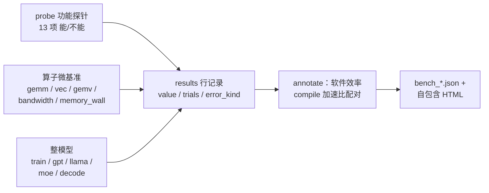

# torchpeak 设计文档：峰值归一化的跨平台 PyTorch 基准

Nov 9, 2026 · @lwzhenglittle

> English version: [design.md](design.md)

## 目标

一套代码、一条命令，在 NVIDIA (CUDA) / AMD (ROCm) / Intel (XPU) / Apple (MPS) / 华为 (NPU) /
摩尔线程 (MUSA) / CPU——或任何其他实现了 torch 设备 API 的后端——上输出同一格式的性能数据。每次运行产出：

- **实测吞吐**：TFLOPS / GB/s / img/s / tok/s，按测试行记录中位数与波动；
- **软件效率 = 实测 / 硬件峰值**：规格口径与实测上限口径并列（见「测量模型」）；
- **eager 与 torch.compile 的成对对比**：加速比、冷/热编译时间、峰值显存、数值校验、
  dynamo graph break 计数；
- **功能可用性矩阵**：autocast 精度、SDPA 各后端、GradScaler、channels_last、int8 mm、
  compile 前反向、pin_memory，逐项记录 能/不能 + 错误文本。

全部负载使用固定种子的合成数据：不下载模型、不依赖数据集，跑通「一条命令 → 一份 JSON +
一份自包含 HTML」的闭环。

## 与现有方案的关系

设计取舍参考了现有基准的口径边界：

| 方案 | 测什么 | torchpeak 的差异化取舍 |
| --- | --- | --- |
| [TorchInductor Performance Dashboard](https://pytorch.org/docs/2.1/_sources/torch.compiler_performance_dashboard.rst.txt)（TorchBench / HuggingFace / TIMM） | 每晚测 compile 相对 eager 的几何平均加速比、编译时间、显存压缩比 | 加速比只作辅助指标（加速比高可能只是 eager 弱）；主指标按峰值归一化，使异构设备可比；覆盖消费级与端侧硬件 |
| [AMD 内部 Inductor dashboard](https://rocm.blogs.amd.com/artificial-intelligence/pytorch-amd-gpus/README.html) | 预发布 ROCm、新 Triton、MI350 | 方法、代码、原始日志全部公开，任何人可复跑同一命令 |
| [Intel 博客数据](https://pytorch.org/blog/pytorch-2-7-intel-gpus/) | Dynamo 基准在 Arc B580 上的 compile 加速比 | 默认参数主赛道与 `--tuned` 调优分道记录（TF32、cudnn.benchmark 等写入 `meta.tuned`） |
| [MLPerf Training](https://www.hpcwire.com/?p=191729) | 跨厂商、重度调优的训练到收敛时间 | 测默认配置下的开箱吞吐；统一 runner、统一 JSON 格式，避免各队配置不同导致的[可比性问题](https://the-decoder.com/?p=33904) |
| 社区零散测试 | 单模型、单平台 | 方法固定（预热、重复次数、统计口径在代码里写死），结果跨平台可合并对比 |

## 测量模型

$$\text{软件效率} = \frac{\text{实测吞吐（FLOP/s 或 B/s）}}{\text{硬件峰值（同精度 FLOP/s 或 B/s）}}$$

计算受限负载（GEMM、整模型）对照算力峰值，访存受限负载（GEMV、bandwidth、KV-cache 解码）
对照带宽峰值。分母有两种口径，并列报告：

- **规格口径**：`peaks.json` 内置表（每条含 `basis` 推导与 `sources` 出处）；
  `--peaks FILE` 前插覆盖条目，`$TORCHPEAK_PEAKS` 重定位文件路径。
- **实测上限口径**：本次运行内同一 (指标维度, 精度) 的最佳值。规格缺失或不可信的设备
  依然有可解释的列；两个口径的差值本身就是信息。

设备显存带宽与主机互连带宽是两个独立维度（`device_bw` / `host_bw`）：H2D/D2H 永远不除以
DRAM 峰值，可选的 `host_bw_gbs` 条目提供互连分母。`device_bw` 的实测上限只取 DRAM 区间
STREAM 算子（read/write/copy）的包络——L2 内尺寸、GEMV、memory mountain 与模型级权重带宽
保留逐行比值，但不抬高上限。

| 指标 | 定义 | 用途 |
| --- | --- | --- |
| 通过率 | 功能探针通过项占比 | 哪些代码路径存在且可用 |
| 软件效率 | 实测值 / 理论峰值（算力或带宽） | 异构设备统一可比 |
| 绝对吞吐 | samples/s 或 tokens/s | 实际有多快 |
| compile 加速比 | compile 吞吐 / eager 吞吐 | 编译器收益（REGRESS < 1.0 单独标记） |
| 编译时间 | 冷缓存 / 热缓存首步耗时 | compile 的代价 |
| 峰值显存 | 完整一步（含优化器状态）的 allocated + reserved | iGPU/UMA 上两个口径差距大，都记录 |
| 数值误差 | vs eager 同精度 + vs fp32 参考的双口径 | 结果可信度 |
| 回退率 | dynamo graph break 数 / 图数量 / 帧覆盖 | 编译器覆盖度 |

## 三层测量

**第一层：功能探针（`probes.py`）。** 每项一个小用例，异常只进结果不刷屏；「不可用」与
错误文本本身就是数据，聚合成通过率写入 `meta.usability`。

**第二层：算子微基准（`ops.py`）。**

| 测试 | 设计意图 |
| --- | --- |
| `gemm` 方阵 + LLM 非方阵（1024×4096×11008 等），fp32/fp16/bf16 + int8 | 张量核路径；非方阵暴露调度与 tile 选择问题 |
| `gemv` m=1，按搬运字节（读 W + 读 x + 写 y）报 GB/s | 带宽受限负载的正确计分维度 |
| `vec` FMA 链，torch 路径 vs 原生 Triton packed-fp16 kernel | torch `opmath` 把 fp16/bf16 逐元素提升到 fp32（Triton TTIR 可验证），torch 路径测的是 fp32 率；native kernel 保持 fp16 运算以暴露 half2 打包率（Arc B390：6.4 vs 13.4 vs 峰值 15.36） |
| `bandwidth` read/write/copy + h2d/d2h，L2 内与超出 L2 各一个尺寸（套件精简时去掉 pinned 变体） | 设备侧与互连侧带宽分开测；两个尺寸区分缓存与 DRAM 区间 |
| `memory_wall` CSAPP memory mountain：读吞吐 × 工作集 × 步长矩阵 | 区分 L1/L2/L3/DRAM 区间；主数值取最大工作集 stride-1 单元，缓存区单元只进热力图 |

**第三层：整模型（`models.py`）。** 覆盖不同瓶颈的负载组合：CNN（resnet50、mobilenet_v3、
efficientnet_b0、vgg16）、ViT、BERT-base（纯 PyTorch 实现，无需 transformers）、GPT 小规模
训练 + prefill、1B 级 Llama 结构（RMSNorm / SwiGLU / RoPE，长序列 prefill + bs1 KV cache
解码）、小型稀疏 MoE（top-k 布尔索引路由制造动态 shape 与 graph break）、GPT-2 medium
bs1 逐 token 解码（对应 llama.cpp 的 tg，主测权重带宽）。训练测试含 SGD/AdamW + AMP，
OOM 时自动减半 batch；可选项 `--hf-model` 用真实 HF 权重补一行解码测试。

## 计时与统计

- **自适应计时**（`harness.timeit`）：固定预热后迭代数翻倍增长，直到累计时长 ≥
  `--min-time`（默认 1 s；`--strict` 或 compile 对比下 3 s），避免短内核被 launch 开销主导。
- **自适应轮数与离群点**：3 轮基线，CV 超过 5% 扩到 5 轮，5 轮剔除离群点后仍高于 5% 再扩到
  7 轮（初测 CV 超过 10% 直接扩到 7 轮）；最终轮数下按 Iglewicz-Hoaglin 修正 z 分数
  （0.6745·|x−中位数|/MAD > 3.5）最多剔除 1 个点（n=7 时 2 个），再对剩余数据重算中位数/CV/IQR。
  仍高于 CV 5% 的行标 `UNSTABLE`（数据照报）；完整 trial 列表、`n_used` 与被剔除点保留在 JSON
  中以供审计。`--strict` 固定 7 轮。编译冷启动时间刻意不参与剔除——冷编译天然重尾，
  剔离群点会抹掉真实行为。
- **DVFS 预热**：共享功耗域的 iGPU 上短内核随频率状态波动 ±40%，`vec` 计时前空转 ≥ 2 s
  等待频率稳定。
- **子项冷却**：`--cooldown` 指定子项间空闲秒数（默认 2），避免上一子项的 DVFS/热状态压低
  下一子项；同一子项内各轮保持连续执行（预热一致性）。
- **固定种子与合成数据**：同一配置任何机器可复跑；数据加载不进入测量路径。
- **显存预检**：全量模式按设备总显存 ×85% 估算各测试峰值（compare 对常驻约 3 份 fp32
  实例），放不下的自动降级 quick 预设并在 `meta.vram_check` 记录，`--no-vram-check` 可关闭。

## compile 对比协议

默认启用（`--no-compare-compile` 关闭，`--compile` 只跑编译侧）：

- **AB/BA 交替**：同一测试 eager/compile 两种顺序各跑一遍，消除顺序与缓存效应。
- **编译时间分冷/热**：清空 inductor 缓存目录测冷启动，二次编译测热缓存。
- **数值双口径**：compile 结果同时对照 eager 同精度输出与 fp32 参考，容差按精度分档
  （fp32 1e-4 / fp16 2e-2 / bf16 5e-2）；双侧同 NaN 通过并单独计数
  （`numerical_nan_outputs`）。低精度下 eager vs compile 的硬检查额外允许"eager 自身到
  fp32 参考的距离"作为噪声地板（`numerical_eager_noise_floor`）：eager 与编译内核各自
  累积独立量化噪声，大模型全词表 logits 上少数元素的互差可超过基础容差——真正的
  编译错误仍会以数量级超出地板。
- **dynamo 计数器差分**：前后快照 `torch._dynamo` 的 graph_breaks / unique_graphs /
  frames_total / frames_ok，作为编译器覆盖度的量化指标。
- **加速比**：compile 行写 `speedup_vs_eager`，< 1.0 标记 `compile_regress`——
  「compile 后反而变慢」是真实存在的现象（如 [ROCm 消费级卡上的 Triton 覆盖不均](https://dev.to/pickuma/rocm-in-2026-why-pytorch-on-the-rx-7900-xtx-still-falls-short-for-research-1apa)），必须可见。

## 峰值表机制

`peaks.json` 是数据文件而非代码：每条目含 `match`（设备名子串，不区分大小写）、
`tflops` / `vec_tflops` / `vec_packed_tflops`（按精度）、`int8_tops`、`bw_gbs`、可选
`host_bw_gbs`、`basis`（推导口径）与 `sources`（出处）。匹配按条目顺序取第一个命中，
具体条目（`a100-sxm4-80gb`）排在泛化条目（`a100`）之前；`--peaks` 条目排在内置表之前。
找不到表时退化为仅实测上限口径，不报规格效率。修正峰值或新增设备 = 一个纯 JSON PR。

## 输出格式

- **JSON**（`results/bench_<label>.json`，`meta.format_version` 标记格式版本）：
  `meta` 含环境指纹（torch / python / platform / 驱动 / Triton / ocloc shim / 线程数 /
  完整 args / vram_check / usability / errors 汇总）与命中的峰值条目；`results` 每行含
  trials、value、效率字段、`error_kind`（internal / unsupported / resource / numerical /
  runtime / usage）与原始错误文本。内部错误（`error_kind=internal`）始终以退出码 2 结束，
  不支持的硬件特性默认只记录不失败，`--strict-errors` 把任何错误行升级为退出码 1。
- **HTML**：自包含静态页（内联 SVG，无外部资源与 JS），含可用性矩阵、效率条形图、
  memory mountain 热力图与 compile 加速比表，离线可看。
- **`--compare`**：多个 JSON 并排成表（含效率列、compile 加速比；train 行 batch 不一致
  会标 `!`），用于跨机器 / 跨版本对比。
- **本地化**：控制台消息与 HTML 标签全部是经 `i18n.t()` 的英文源串，`torchpeak/locales/<lang>.json`
  提供译文（现有 en/zh）。语言来自 `--lang`、`$TORCHPEAK_LANG` 或系统 locale；缺键回退英文，
  目录过期不会弄坏任何一次运行。

## 设备抽象与后端适配

- `runtime.pick_device` 按可用性选择后端（`--device` 显式指定）；同步、峰值显存统计、
  cache 清理等操作经 `mod(dev)` 分派到 `torch.cuda / torch.xpu / torch.mps / torch.cpu`，
  能力缺失时安全降级（返回 None 而非崩溃）。
- UMA / iGPU 上 caching allocator 的 reserved 与 allocated 差距大，两个口径都记录。
- **XPU ocloc shim**：Triton-XPU 生成 zebin 时以裸名 `ocloc` 起子进程，而部分发行版只装
  `ocloc-<ver>`；运行前在用户级临时目录建符号链接并入 PATH，`atexit`（含 SIGTERM）回收。
- ROCm 经 `cuda` device type 接入；MPS / NPU / MUSA 走同一抽象，代码路径就绪待硬件验证。

**可移植性契约。** 主测试只用 torch 算子和标准的按后端模块接口——任何实现了 torch 设备
API 的后端都能直接跑。自动检测依次探测 `torch.cuda/xpu/mps.is_available()` 并懒加载
`torch_npu` / `torch_musa`，全部不可用时兜底 CPU。后端相关能力的缺失降级为记录在案的
error 行而非崩溃：无 Triton target 只影响 `vec` 的 triton-native 行（torch 行照常），
`torch._int_mm` 或某个 SDPA 后端缺失只标记对应探针，Inductor 不可用时 compile 行报错、
eager 行照常。接入全新设备类型（六类之外）只需在 `pick_device` 加一行，外加可选的
`peaks.json` 条目——无峰值条目时自动退化为实测上限口径。

## 复现规范

- 预热步数固定；编译时间单独记录，不混进吞吐。
- 每项重复 N 次报中位数与四分位距，方差超阈值标记 UNSTABLE。
- 固定随机种子与合成输入，排除数据加载干扰。
- 结果绑定环境指纹（torch / 驱动 / 编译器版本），跨版本比较时对齐 `meta`。

## 待决问题

- [ ] 默认口径是否允许 channels_last、TF32 这类一行常规优化（当前归入 `--tuned` 赛道）。
- [ ] 峰值表数据来源：厂商规格 + 实测上限并列已落地，是否再自测一份微基准上限作为第三口径。
- [ ] MPS / NPU / MUSA 后端的硬件验证与峰值表补齐。
- [ ] 端侧温控与功耗模式对持续性能的影响是否记录进 meta（当前记录平台信息，不锁频）。

## Sources

- [PyTorch 2.0 Performance Dashboard 文档](https://pytorch.org/docs/2.1/_sources/torch.compiler_performance_dashboard.rst.txt)
- [AMD ROCm blog：PyTorch 生态与 AISWHUD](https://rocm.blogs.amd.com/artificial-intelligence/pytorch-amd-gpus/README.html)
- [PyTorch 2.7 Intel GPUs](https://pytorch.org/blog/pytorch-2-7-intel-gpus/)
- [MLPerf Training v6.0 发布](https://www.hpcwire.com/?p=191729)
- [The Decoder：MLPerf Inference v6.0 可比性](https://the-decoder.com/?p=33904)
- [ROCm in 2026（DEV）](https://dev.to/pickuma/rocm-in-2026-why-pytorch-on-the-rx-7900-xtx-still-falls-short-for-research-1apa)
