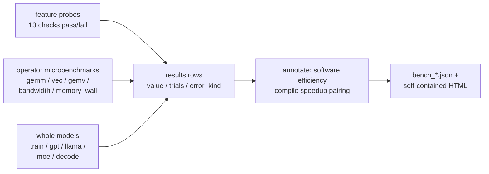

# torchpeak Design Notes: A Cross-Platform, Peak-Normalized PyTorch Benchmark

Nov 9, 2026 · @lwzhenglittle

> English (primary) · [Chinese](design-zh.md)

## Goals

One codebase, one command, emitting performance data in an identical format on NVIDIA (CUDA) / AMD (ROCm) / Intel (XPU) / Apple (MPS) / Huawei (NPU) / Moore Threads (MUSA) / CPU — or any other backend that implements the torch device API. Each run produces:

- **Measured throughput**: TFLOPS / GB/s / img/s / tok/s, with median and variance recorded per test row;
- **Software efficiency = measured / hardware peak**: the spec denominator and the measured-ceiling denominator reported side by side (see "Measurement model");
- **Paired eager vs torch.compile comparison**: speedup, cold/hot compile time, peak VRAM, numerical validation, Dynamo graph-break counts;
- **Usability matrix**: autocast dtypes, individual SDPA backends, GradScaler, channels_last, int8 mm, compile forward/backward, pin_memory — each recorded as pass/fail plus the error text.

All workloads use fixed-seed synthetic data: no model downloads, no dataset dependencies; the loop "one command → one JSON + one self-contained HTML" works end to end.

## Relationship to existing benchmarks

The design trade-offs reference the measurement boundaries of existing benchmarks:

| Approach | What it measures | torchpeak's differentiated trade-off |
| --- | --- | --- |
| [TorchInductor Performance Dashboard](https://pytorch.org/docs/2.1/_sources/torch.compiler_performance_dashboard.rst.txt) (TorchBench / HuggingFace / TIMM) | Nightly geometric-mean compile-vs-eager speedup, compile time, memory compression ratio | Speedup is only a secondary metric (a high speedup may simply mean eager is weak); the primary metric is peak-normalized so heterogeneous devices are comparable; covers consumer and edge hardware |
| [AMD internal Inductor dashboard](https://rocm.blogs.amd.com/artificial-intelligence/pytorch-amd-gpus/README.html) | Pre-release ROCm, new Triton, MI350 | Method, code, and raw logs are all public; anyone can re-run the same command |
| [Intel blog data](https://pytorch.org/blog/pytorch-2-7-intel-gpus/) | Compile speedup of Dynamo benchmarks on Arc B580 | The default-configuration track and the `--tuned` track are recorded separately (TF32, cudnn.benchmark, etc. written to `meta.tuned`) |
| [MLPerf Training](https://www.hpcwire.com/?p=191729) | Cross-vendor, heavily tuned training time-to-convergence | Measures out-of-the-box throughput at default configuration; a unified runner and unified JSON format avoid the [comparability problems](https://the-decoder.com/?p=33904) caused by divergent configurations across teams |
| Scattered community testing | Single model, single platform | Fixed methodology (warm-up, repeat counts, and statistical treatment hard-coded), so results can be merged and compared across platforms |

## Measurement model

$$\text{software efficiency} = \frac{\text{measured throughput (FLOP/s or B/s)}}{\text{hardware peak (FLOP/s or B/s at the same precision)}}$$

Compute-bound workloads (GEMM, whole models) are compared against compute peak; memory-bound workloads (GEMV, bandwidth, KV-cache decode) are compared against bandwidth peak. The denominator comes in two variants, reported side by side:

- **Spec denominator**: the built-in table in `peaks.json` (each entry carries a `basis` derivation and `sources` citations); `--peaks FILE` prepends override entries, and `$TORCHPEAK_PEAKS` relocates the file path.
- **Measured-ceiling denominator**: the best value for the same (metric dimension, dtype) within the current run. Devices with missing or untrustworthy specs still get an interpretable column; the gap between the two denominators is itself information.

Device memory bandwidth and host interconnect bandwidth are two independent dimensions (`device_bw` / `host_bw`): H2D/D2H is never divided by the DRAM peak; an optional `host_bw_gbs` entry supplies the interconnect denominator. The `device_bw` measured ceiling is an envelope over STREAM ops (read/write/copy) at DRAM-regime sizes only — L2-resident sizes, GEMV, the memory mountain and model-level weight bandwidth keep their per-row ratios but never raise the ceiling.

| Metric | Definition | Purpose |
| --- | --- | --- |
| Pass rate | Share of feature probes that pass | Which code paths exist and are usable |
| Software efficiency | Measured value / theoretical peak (compute or bandwidth) | Uniform comparability across heterogeneous devices |
| Absolute throughput | samples/s or tokens/s | How fast it actually is |
| Compile speedup | compile throughput / eager throughput | Compiler benefit (`REGRESS` flagged separately when < 1.0) |
| Compile time | First-step time with cold / hot cache | The cost of compile |
| Peak VRAM | allocated + reserved over a complete step (including optimizer state) | The two figures diverge widely on iGPU/UMA, so both are recorded |
| Numerical error | Dual-reference: vs eager at the same precision + vs an fp32 reference | Confidence in the results |
| Fallback rate | Dynamo graph-break count / graph count / frame coverage | Compiler coverage |

## Three-layer measurement

**Layer 1: feature probes (`probes.py`).** Each check is a small test case; exceptions only enter the results and never flood the console. "Unavailable" and the error text are themselves data, aggregated into the pass rate written to `meta.usability`.

**Layer 2: operator microbenchmarks (`ops.py`).**

| Test | Design intent |
| --- | --- |
| `gemm` square matrices + LLM non-square shapes (1024×4096×11008, etc.), fp32/fp16/bf16 + int8 | Tensor-core path; non-square shapes expose scheduling and tile-selection problems |
| `gemv` m=1, reported in GB/s over bytes moved (read W + read x + write y) | The correct scoring dimension for a bandwidth-bound workload |
| `vec` FMA chain, torch path vs a native Triton packed-fp16 kernel | torch `opmath` promotes fp16/bf16 elementwise ops to fp32 (verifiable in Triton TTIR), so the torch path measures the fp32 rate; the native kernel keeps arithmetic in fp16 to expose the half2 packed rate (Arc B390: 6.4 vs 13.4 vs 15.36 peak) |
| `bandwidth` read/write/copy + h2d/d2h, one L2-resident and one DRAM size (pinned variants dropped with the suite slimming) | Device-side and interconnect-side bandwidth measured separately; the two sizes separate the cache and DRAM regimes |
| `memory_wall` CSAPP memory mountain: read throughput × working set × stride matrix | Separates the L1/L2/L3/DRAM regimes; the headline number comes from the largest-working-set stride-1 cell, while cache-resident cells only enter the heatmap |

**Layer 3: whole models (`models.py`).** A workload mix covering different bottlenecks: CNN (resnet50, mobilenet_v3, efficientnet_b0, vgg16), ViT, BERT-base (pure PyTorch implementation, no transformers needed), small-scale GPT training + prefill, a 1B-class Llama structure (RMSNorm / SwiGLU / RoPE, long-sequence prefill + bs1 KV cache decode), a small sparse MoE (top-k boolean-index routing creating dynamic shapes and graph breaks), and GPT-2 medium bs1 token-by-token decode (the equivalent of llama.cpp's tg, primarily measuring weight bandwidth). Training tests include SGD/AdamW + AMP and automatically halve the batch on OOM; the optional `--hf-model` adds one decode row using real HF weights.

## Timing and statistics

- **Adaptive timing** (`harness.timeit`): after a fixed warm-up the iteration count doubles until the accumulated time reaches ≥ `--min-time` (1 s default; 3 s under `--strict` or compile comparison), so short kernels are not dominated by launch overhead.
- **Adaptive rounds and outliers**: a 3-round baseline is extended to 5 rounds when CV exceeds 5%, and to 7 rounds when the 5-round result is still above 5% after outlier removal (an initial CV above 10% goes straight to 7); after the final round count at most one point (two at n=7) is removed by the Iglewicz-Hoaglin modified z-score (0.6745·|x−median|/MAD > 3.5) and the median/CV/IQR are recomputed on what remains. Rows still above CV 5% are tagged `UNSTABLE` (reported anyway); the full trial list, `n_used` and the removed points stay in the JSON for auditability. `--strict` runs a fixed 7 rounds. Compile cold-start times are deliberately excluded — cold compile is fat-tailed by nature and outlier removal would erase real behavior.
- **DVFS warm-up**: on iGPUs in a shared power domain, short kernels swing ±40% with clock state, so `vec` spins idly for ≥ 2 s before timing to let clocks settle.
- **Subtest cooldown**: `--cooldown` idle seconds (default 2) between subtests so DVFS/thermal state from one subtest does not depress the next; trials within a subtest stay back-to-back (warm-up consistency).
- **Fixed seeds and synthetic data**: any machine can re-run the same configuration; data loading never enters the measurement path.
- **VRAM pre-check**: in full mode, each test's peak VRAM is estimated up front (a compare pair keeps roughly 3 fp32 instances resident) and checked against 85% of the device total; oversized tests are automatically downgraded to the quick preset and recorded in `meta.vram_check`; `--no-vram-check` turns it off.

## Compile comparison protocol

Enabled by default (`--no-compare-compile` disables it; `--compile` runs the compile side only):

- **AB/BA alternation**: each test runs once in each eager/compile order to cancel ordering and cache effects.
- **Cold/hot compile time**: clear the Inductor cache directory to measure cold start, and recompile to measure the hot cache.
- **Dual-reference numerical checks**: compile results are checked against both the eager output at the same precision and an fp32 reference, with per-dtype tolerances (fp32 1e-4 / fp16 2e-2 / bf16 5e-2); identical NaN on both sides passes and is counted separately (`numerical_nan_outputs`).
- **Dynamo counter deltas**: snapshot `torch._dynamo`'s graph_breaks / unique_graphs / frames_total / frames_ok before and after, as quantitative compiler-coverage metrics.
- **Speedup**: compile rows record `speedup_vs_eager`; < 1.0 is flagged `compile_regress` — "slower after compile" is a real phenomenon (e.g. [uneven Triton coverage on consumer ROCm cards](https://dev.to/pickuma/rocm-in-2026-why-pytorch-on-the-rx-7900-xtx-still-falls-short-for-research-1apa)) and must stay visible.

## Peak table mechanics

`peaks.json` is a data file, not code: each entry contains a `match` (case-insensitive device-name substring), `tflops` / `vec_tflops` / `vec_packed_tflops` (per dtype), `int8_tops`, `bw_gbs`, an optional `host_bw_gbs`, a `basis` (derivation basis), and `sources` (citations). Matching takes the first hit in entry order, with specific entries (`a100-sxm4-80gb`) placed before generic ones (`a100`); `--peaks` entries are placed before the built-in table. When no table is found, the tool degrades to the measured-ceiling denominator only and reports no spec efficiency. Correcting a peak or adding a device is a pure JSON PR.

## Output format

- **JSON** (`results/bench_<label>.json`, with `meta.format_version` marking the schema version): `meta` holds the environment fingerprint (torch / python / platform / driver / Triton / ocloc shim / thread count / full args / vram_check / usability / errors summary) plus the matched peak entries; each `results` row contains trials, value, efficiency fields, `error_kind` (internal / unsupported / resource / numerical / runtime / usage), and the raw error text. Internal errors (`error_kind=internal`) always end with exit code 2; unsupported hardware features are recorded by default without failing the run, and `--strict-errors` promotes any error row to exit code 1.
- **HTML**: a self-contained static page (inline SVG, no external resources or JS) with the usability matrix, efficiency bar charts, the memory mountain heatmap, and the compile speedup table; viewable offline.
- **`--compare`**: lays multiple JSONs side by side in a table (including efficiency columns and compile speedup; mismatched batch sizes on train rows are flagged `!`) for cross-machine / cross-version comparison.
- **Localization**: every console message and HTML label is an English source string passed through
  `i18n.t()`; `torchpeak/locales/<lang>.json` catalogs translate it (en/zh today). Language comes
  from `--lang`, `$TORCHPEAK_LANG`, or the system locale; missing keys fall back to English, so a
  stale catalog never breaks a run.

## Device abstraction and backend adaptation

- `runtime.pick_device` selects a backend by availability (`--device` explicitly overrides); operations such as synchronization, peak-VRAM accounting, and cache clearing are dispatched via `mod(dev)` to `torch.cuda / torch.xpu / torch.mps / torch.cpu`, degrading safely when a capability is missing (returning None instead of crashing).
- On UMA / iGPU the caching allocator's reserved and allocated figures diverge widely, so both are recorded.
- **XPU ocloc shim**: when generating zebin, Triton-XPU spawns a subprocess under the bare name `ocloc`, while some distributions ship only `ocloc-<ver>`; before the run, a symlink is created in a user-level temp directory and added to PATH, then cleaned up via `atexit` (including on SIGTERM).
- ROCm attaches through the `cuda` device type; MPS / NPU / MUSA go through the same abstraction, with code paths ready pending hardware verification.

**Portability contract.** The main tests are pure torch operators plus the standard per-backend
module interface — any backend that implements the torch device API can run them. Auto-detection
probes `torch.cuda/xpu/mps.is_available()` and lazy-imports `torch_npu` / `torch_musa`, falling
back to CPU. Missing backend-specific capabilities degrade to recorded error rows rather than a
crashed run: no Triton target fails only the `vec` triton-native row (torch rows unaffected), a
missing `torch._int_mm` or SDPA backend only marks the matching probe, and where Inductor is
unavailable the compile rows error while eager rows still run. Integrating a brand-new device type
(beyond the six built in) is one line in `pick_device` plus an optional `peaks.json` entry —
without a peak entry the run degrades to the measured-ceiling denominator.

## Reproducibility conventions

- Warm-up steps are fixed; compile time is recorded separately and never mixed into throughput.
- Each item repeats N times, reporting median and interquartile range; variance above the threshold is flagged UNSTABLE.
- Fixed random seeds and synthetic inputs rule out data-loading interference.
- Results are bound to an environment fingerprint (torch / driver / compiler version); align `meta` when comparing across versions.

## Open questions

- [ ] Should the default configuration allow one-line conventional optimizations such as channels_last and TF32 (currently assigned to the `--tuned` track).
- [ ] Peak-table data sources: vendor specs + measured ceiling are already reported side by side — should a self-measured microbenchmark ceiling be added as a third denominator.
- [ ] Hardware verification for the MPS / NPU / MUSA backends and completion of their peak-table entries.
- [ ] Whether edge-device thermal throttling and power modes should be recorded in meta as factors affecting sustained performance (currently platform info is recorded, but clocks are not locked).

## Sources

- [PyTorch 2.0 Performance Dashboard documentation](https://pytorch.org/docs/2.1/_sources/torch.compiler_performance_dashboard.rst.txt)
- [AMD ROCm blog: PyTorch ecosystem and AISWHUD](https://rocm.blogs.amd.com/artificial-intelligence/pytorch-amd-gpus/README.html)
- [PyTorch 2.7 Intel GPUs](https://pytorch.org/blog/pytorch-2-7-intel-gpus/)
- [MLPerf Training v6.0 release](https://www.hpcwire.com/?p=191729)
- [The Decoder: MLPerf Inference v6.0 comparability](https://the-decoder.com/?p=33904)
- [ROCm in 2026 (DEV)](https://dev.to/pickuma/rocm-in-2026-why-pytorch-on-the-rx-7900-xtx-still-falls-short-for-research-1apa)
